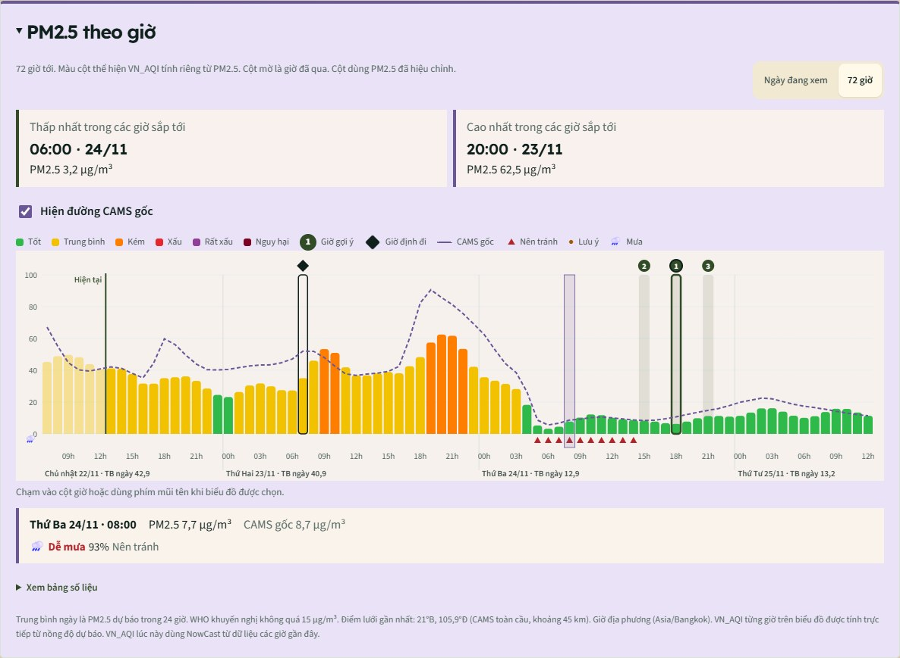

# ClearHour – Chọn đúng giờ, bớt hít bụi

**ClearHour** (tạm dịch: "giờ trong lành") là web app dùng dự báo bụi mịn PM2.5 theo giờ để trả lời một câu hỏi cụ thể: **giữa giờ bạn định đi và những lúc bạn rảnh, nên giữ lịch hay dời sang giờ nào**. App cũng giúp trường học, doanh nghiệp quyết định tổ chức hoạt động ngoài trời bình thường, giảm cường độ hay chuyển vào trong nhà.

🔗 **Bản demo:** https://btphuong3011.github.io/clearhour/

Chọn **Tiếng Việt / English** trên thanh điều hướng để đổi ngôn ngữ. ClearHour ghi nhớ lựa chọn và lưu ngôn ngữ trong link chia sẻ.

Dự án demo cho **Youth Digital Citizen Challenge 2026** – chủ đề *Urban Air-chitects: Designing Healthier Air for Cities* (UNDP Việt Nam & Chính phủ Nhật Bản).



*Biểu đồ Hà Nội với bản dự báo lấy ngày 22/11/2026. Tam giác đánh dấu giờ nên tránh, chấm tròn là lưu ý. Nét đứt là PM2.5 từ CAMS trước hiệu chỉnh.*

*[English summary below](#english-summary)*

---

## Vấn đề

- Nồng độ PM2.5 trung bình ở Việt Nam năm 2024 là **28,7 µg/m³**, gấp 5–7 lần mức khuyến nghị trung bình năm của WHO.
- Ô nhiễm không khí liên quan đến **hơn 70.000 ca tử vong mỗi năm** và gây thiệt hại ít nhất **13 tỷ USD/năm** (~4% GDP).

Người dân xem được "AQI hôm nay" nhưng con số đó hiếm khi trả lời câu hỏi thực tế: *"Vậy mấy giờ thì mình nên đi chạy bộ / đưa con ra công viên / xếp ca giao hàng?"*

Trong khi đó, bụi mịn **thay đổi rất mạnh trong ngày**. Ví dụ theo dữ liệu mô hình CAMS cho Hà Nội ngày 30/10/2026: khoảng 55 µg/m³ lúc 3–6 giờ sáng, nhưng chỉ khoảng 16 µg/m³ lúc 10 giờ sáng đến 5 giờ chiều. **Dời giờ** là cách giảm phơi nhiễm rẻ nhất, ai cũng làm được ngay.

## Giải pháp

| Tính năng | Mô tả |
|---|---|
| **Bầu trời theo giờ** | Cảnh minh họa Hồ Hoàn Kiếm đổi sắc theo giờ. Kéo thanh trượt để đọc PM2.5 dự báo theo từng giờ của thành phố đang xem, rồi đưa một khung sắp tới vào phần so sánh. |
| **Tình huống Hà Nội** | Chạy thử bằng dữ liệu mẫu ngày 31/10/2026, với giờ định đi và thời gian rảnh điền sẵn. Demo chạy độc lập với Open-Meteo và ghi rõ nguồn dữ liệu. |
| **Câu chuyện "Một buổi sáng của Minh"** | Nút "Xem câu chuyện 30 giây" mở 5 cảnh kể lại cách Minh dùng ClearHour cho buổi chạy 6 giờ sáng mai, bằng dự báo thật của thành phố đang chọn. Kết thúc đổi theo dữ liệu: có hôm nên dời giờ, có hôm cứ giữ giờ cũ. Mở thẳng bằng link có `#cau-chuyen`. |
| **So sánh giờ ra ngoài** | Chọn giờ bạn định đi (hoặc thường đi) và tối đa 3 khoảng rảnh rời nhau, ví dụ trước và sau giờ làm. App trả lời thẳng: "Nên dời sang 13:00–14:00, bụi mịn dự báo thấp hơn 51%" hoặc "Giữ lịch cũ" khi các lúc rảnh khác không tốt hơn đáng kể. Lúc rảnh nào nhiều bụi hơn giờ định đi thì không đề xuất. |
| **Mưa, nắng nóng, UV, ozone** | Mỗi khung kèm nhãn "Dễ mưa", "Trời nóng", "Tia UV rất cao", "Ozone cao" từ dự báo thời tiết. ClearHour xét các cảnh báo mức nên tránh trước khi so bụi mịn. Nếu mọi giờ có dữ liệu đều có cảnh báo mức này, app báo chưa có giờ phù hợp. Dự báo không khí hiển thị trước; kết luận cập nhật sau khi có thời tiết. |
| **Dự báo đúng đến đâu?** | Mỗi ngày so dự báo với số đo trạm của khoảng 60 ngày qua, công bố tỉ lệ đoán đúng mức không khí, tỉ lệ chỉ đúng giờ nào ít bụi hơn và sai số trước/sau hiệu chỉnh. Có trạm quan trắc chuẩn trong 30 km và hiệu chỉnh giúp tốt hơn thì app dùng bản đã hiệu chỉnh (vẫn xem được bản gốc). |
| **Nhìn lại 30 ngày** | Cá nhân: "nếu hôm nào cũng làm theo gợi ý thay vì luôn đi 6 giờ sáng, bạn hít ít bụi hơn khoảng X%; có Y/30 ngày đáng đổi giờ". Trường học, doanh nghiệp: bản đồ màu 30 ngày × giờ trong ngày, số ngày ổn của từng khung và giờ thường sạch nhất để xếp lịch cố định. |
| **Hành động sau quyết định** | Khung đã chọn đưa được vào Google Lịch, tải tệp .ics (nhắc trước 15 phút), hoặc sao chép thành tin nhắn rủ nhóm có ngày giờ cụ thể, mức bụi dự báo và link lưu cả giờ định đi lẫn khung đã chọn. Link mở sau khi khung giờ kết thúc vẫn ghi rõ lịch gốc. |
| **Độ tin cậy của dữ liệu** | Một dòng ngay dưới gợi ý cho biết trạm đo gần nhất (OpenAQ) khớp hay lệch với mô hình, hoặc không có trạm để đối chiếu. Khi trạm đo còn mới và đang xấu hơn dự báo, lời khuyên sức khỏe theo trạm đo. |
| **Không khí lúc này** | VN_AQI giờ (Nowcast cho bụi, trung bình 1 giờ cho ozone), PM2.5 và O₃ giờ này, số đo trạm gần nhất, khuyến nghị theo nhóm người (trẻ em, người cao tuổi, người có bệnh hô hấp – tim mạch, phụ nữ mang thai). Các phép so sánh theo ngày (ngưỡng WHO 24 giờ, quy đổi điếu thuốc) nằm riêng trong phần mở rộng để không lẫn với số liệu theo giờ. |
| **Biểu đồ theo giờ** | Dải cảnh báo đặt dưới cột PM2.5. Chạm cột hoặc dùng phím mũi tên để xem cảnh báo chi tiết. Khi địa điểm có hiệu chỉnh, có thể bật đường CAMS gốc để so sánh trên cùng thang đo. Có cả chế độ 72 giờ và bảng số liệu. |
| **Trong nhà: giờ mở cửa sổ** | Dải 24 giờ cho biết lúc nào nên mở cửa thông gió, lúc nào chỉ mở ngắn và lúc nào nên đóng kín, bật máy lọc. |
| **Lịch cố định: trường học & doanh nghiệp** | Nhập các khung hoạt động ngoài trời (giờ thể dục, ra chơi, ca giao hàng…). App đánh giá từng khung trong 3 ngày tới theo mức đỉnh và trung bình, rồi **soạn sẵn thông báo** cho phụ huynh hoặc nhân viên. |
| **In báo cáo** | Nút **In báo cáo** mở bản A4 của lịch trường học hoặc ca làm đang xem, có nguồn dữ liệu, giờ cập nhật, tổng lượt theo khuyến nghị và tóm tắt lịch sử nếu có. Có thể chọn lưu PDF trong hộp thoại in. |

Ngoài ra: 12 đô thị lớn, "Vị trí của tôi", giao diện sáng/tối, chạy tốt trên điện thoại, link chia sẻ giữ nguyên lựa chọn kể cả khoảng rảnh và giờ định đi (`?city=hanoi&free=5-7,17-21&plan=1.7`), và **tự chuyển sang dữ liệu mẫu có ghi rõ ngày** nếu API lỗi.

### Vì sao không "đổi tiết thể dục"?

Thời khóa biểu của trường hay ca làm của doanh nghiệp thường không dời được theo dự báo, và khi đổi thì lý do chính là lịch của giáo viên, học sinh chứ không phải bụi mịn. Điều các đơn vị này thật sự quyết định được là **tổ chức bình thường, giảm cường độ hay chuyển vào trong nhà**, nên phần "Lịch cố định" chỉ đưa ra đúng ba mức đó. Việc chọn giữa các giờ khả thi dành cho người có lịch linh hoạt: cá nhân, nhóm chạy bộ, đội bóng, câu lạc bộ.

## Cách hoạt động

1. **Dữ liệu:** lấy dự báo PM2.5, PM10 và O₃ theo giờ (1 ngày trước + 4 ngày tới) từ [Open-Meteo Air Quality API](https://open-meteo.com/en/docs/air-quality-api), dựa trên mô hình CAMS của Copernicus; xác suất mưa, nhiệt độ cảm nhận và chỉ số UV từ [Open-Meteo Forecast API](https://open-meteo.com/en/docs).
2. **Chỉ số VN_AQI:** nội suy tuyến tính theo bảng BPi của [QĐ 1459/QĐ-TCMT (2019)](https://cem.gov.vn/storage/news_file_attach/QD%201459%20TCMT%20ngay%2012.11.2019%20AQI.pdf), lấy giá trị lớn nhất giữa PM2.5, PM10 và O₃ (O₃ dùng bảng trung bình 1 giờ). Giá trị "ngay lúc này" của bụi dùng **Nowcast** (trung bình có trọng số 12 giờ gần nhất, w = max(Cmin/Cmax, 0,5)) đúng như quy định. Bộ test kiểm chứng với ví dụ tính mẫu trong văn bản.
   **Cảnh báo thời tiết** (ngưỡng giả định để nhắc cho dễ hiểu): xác suất mưa ≥ 60% hoặc nhiệt độ cảm nhận ≥ 40°C thì không đề xuất; ≥ 35°C nhắc "Trời nóng"; UV ≥ 8 nhắc che chắn; O₃ ở mức Kém trở lên thì không đề xuất.
3. **Tìm và so sánh khung giờ:** trượt cửa sổ thời gian trên các khoảng rảnh, xếp theo PM2.5 trung bình tăng dần, lấy tối đa 3 khung cách nhau ít nhất 2 giờ. Mỗi khung được so với giờ người dùng định đi: chênh dưới 10% hoặc dưới 3 µg/m³ thì coi là tương đương và khuyên giữ lịch cũ, vì mức chênh đó nhỏ hơn sai số thường gặp của dự báo.
4. **Lượng bụi hít vào** ≈ nồng độ (µg/m³) × mức thông khí (m³/giờ) × thời gian, theo US EPA *Exposure Factors Handbook* (2011): nhẹ ~0,7, vừa ~1,6, mạnh ~3,0 m³/giờ. Chỉ hiện cho hồ sơ người trưởng thành vì hệ số là của người lớn.
5. **Quy đổi điếu thuốc:** theo Berkeley Earth, hít thở không khí có PM2.5 trung bình 22 µg/m³ trong một ngày tương đương hút khoảng 1 điếu thuốc lá.
6. **Khuyến nghị sức khỏe:** theo Bảng 5 của QĐ 1459 (người bình thường / nhóm nhạy cảm).
7. **Giờ mở cửa sổ:** PM2.5 ≤ 25 µg/m³ (mức Tốt) thì mở thoải mái, ≤ 50 µg/m³ (Trung bình) thì chỉ mở ngắn, cao hơn thì đóng kín.
8. **Số đo trạm:** GitHub Actions chạy [scripts/fetch-stations.mjs](scripts/fetch-stations.mjs) theo lịch mỗi giờ (thực tế GitHub chạy thưa hơn, vài giờ một lần), lấy số đo PM2.5 mới nhất của các trạm tại Việt Nam từ [OpenAQ](https://openaq.org/) rồi đưa vào bản deploy dưới dạng `data/stations.json`. App hiện số đo trong vòng 12 giờ, ghi rõ đo lúc nào và so với dự báo của mô hình tại đúng giờ đo; hai nguồn được coi là khớp khi chênh không quá 10 µg/m³ hoặc không quá 1,5 lần. API key nằm trong GitHub Secrets nên không lộ ra trình duyệt, và cũng không tạo commit rác.
9. **Kiểm tra và hiệu chỉnh dự báo:** [scripts/accuracy.mjs](scripts/accuracy.mjs) lấy số đo PM2.5 từng giờ của các trạm trong `data/stations.json` từ [kho lưu trữ công khai của OpenAQ](https://openaq.org/) trên AWS (không cần key), ghép với dữ liệu mô hình cùng giờ tại đúng tọa độ trạm trong 60 ngày. 2/3 thời gian đầu dùng để học hệ số theo giờ trong ngày (tỉ số tổng số đo / tổng dự báo, kéo về hệ số chung khi ít mẫu, làm trơn và giới hạn trong 0,25–4), 1/3 sau dùng để chấm điểm. Chỉ bật hiệu chỉnh cho trạm quan trắc chuẩn khi sai số giảm ít nhất 5% và thứ tự giờ không kém đi; cảm biến giá rẻ chỉ dùng để đối chiếu. Kết quả nằm trong `data/accuracy.json` của bản deploy, tính lại tối đa mỗi ngày một lần.
   Kết quả ngày 21/11/2026 tại trạm Công viên Nhân Chính (Hà Nội): đoán đúng mức không khí 56% → 69% số giờ, chỉ đúng giờ nào ít bụi hơn 56% → 71% số cặp giờ, sai số trung bình 12 → 8,5 µg/m³. Ở trạm này, số đo khớp với dự báo thô nhất khi dời lệch nhau 2–3 giờ, tức dự báo có vẻ trễ pha so với thực tế; hệ số theo giờ trong ngày bù được một phần (mới kiểm tra ở một trạm, cần thêm dữ liệu).
10. **Nhìn lại 30 ngày:** dùng dữ liệu từng giờ 30 ngày qua của Open-Meteo (đã hiệu chỉnh nếu có), mỗi ngày tìm khung ít bụi nhất trong khoảng rảnh và chỉ "đổi giờ" khi ClearHour cũng sẽ gợi ý đổi. Đây là kết quả biết trước, tức mức tốt nhất khi dự báo luôn đúng.

### Dễ dùng cho mọi người

Giao diện ưu tiên lời nói thường ngày hơn con số: giờ ghi kiểu "5:00 chiều", mức không khí đi kèm biểu cảm (😊 Tốt, 🙂 Trung bình, 😐 Kém, 😷 Xấu…), chữ cỡ lớn và nút bấm to. Mọi con số (µg/m³, số đo trạm, cách tính) gom vào mục "Chi tiết số liệu"; biểu đồ theo giờ được gập lại, ai cần mới mở.

## Giới hạn

- Đây là **dữ liệu dự báo từ mô hình** với ô lưới khoảng 45 km, không chi tiết đến từng phường và không thay thế số liệu trạm quan trắc chính thức. Hiệu chỉnh chỉ có ở nơi có trạm quan trắc chuẩn đủ dữ liệu (hiện là Hà Nội).
- Phần kiểm tra độ chính xác dùng dữ liệu quá khứ của Open-Meteo, vốn là mô hình chạy sát giờ chứ không phải bản dự báo trước 1–3 ngày, nên sai số thật của dự báo xa có thể lớn hơn. Open-Meteo chỉ lưu khoảng 3 tháng gần nhất, nên hệ số hiệu chỉnh mới theo mùa trong ngắn hạn.
- Nồng độ sát mặt đường đông xe thường cao hơn mức nền của mô hình.
- Chỉ số theo từng giờ trong tương lai được quy đổi trực tiếp từ nồng độ dự báo, không dùng Nowcast.
- Các ngưỡng "đáng để đổi lịch" (10%, 3 µg/m³) và "trạm khớp mô hình" là giả định ban đầu, chưa được kiểm chứng với người dùng và dữ liệu dài ngày.
- Lượng bụi hít vào chỉ là ước tính. **Không phải lời khuyên y tế.**

## Hướng phát triển

- **Hiệu chỉnh dự báo bằng học máy:** từ hệ số theo giờ trong ngày hiện nay lên mô hình có thêm thời tiết, mùa và độ trễ pha; lưu lại bản dự báo đã phát hành để chấm điểm đúng dự báo trước 1–3 ngày. Mở rộng tới độ chi tiết quận, phường khi có thêm cảm biến.
- **Nhắc lịch chủ động:** bot Telegram / Zalo OA nhắn mỗi tối "Khung chạy bộ tốt nhất ngày mai: 16–17h".
- **Nhật ký phơi nhiễm:** "Tháng này bạn tránh được X µg bụi mịn ≈ Y điếu thuốc", vừa tạo động lực vừa đo được tác động.
- **Trợ lý AI hỏi đáp:** trả lời câu hỏi tự do ("Con tôi bị hen, chiều nay đá bóng được không?") dựa trên dữ liệu của app và khuyến nghị của QĐ 1459.
- **Mô hình bền vững:** cá nhân dùng miễn phí; trường học và doanh nghiệp có lao động ngoài trời (giao hàng, xây dựng) trả phí cho bảng điều khiển xếp ca và báo cáo phơi nhiễm hằng tháng; tài trợ CSR.
- Gợi ý tuyến đường ít ô nhiễm khi có dữ liệu chi tiết theo không gian.

## Kho dự báo đã lấy

Workflow [Capture ClearHour forecast](.github/workflows/forecast-archive.yml) lấy dữ liệu cho 12 thành phố mỗi 6 giờ và ghi từng bản vào [nhánh `forecast-archive`](https://github.com/btphuong3011/clearhour/tree/forecast-archive/snapshots). Kho nằm riêng với bản triển khai GitHub Pages.

- Mỗi bản ghi giữ thời điểm lấy dữ liệu UTC, tọa độ thành phố, ô lưới và giờ dự báo, phiên bản mã, dữ liệu PM2.5/PM10/O₃, thời tiết và thông số hiệu chỉnh đã công bố khi có thể tải được.
- Kho ghi lúc bắt đầu truy cập API và lúc nhận xong các nguồn. Bộ chấm dùng mốc dữ liệu có sẵn; các bản lưu cũ dùng giờ truy cập API. Hai mốc này khác giờ dự báo có hiệu lực và giờ mô hình khởi chạy.
- Mất dữ liệu thời tiết hoặc hiệu chỉnh được ghi rõ trong bản lưu. Nếu thiếu dự báo không khí, workflow báo lỗi và không tạo bản ghi rỗng.

### Kiểm chứng quyết định đổi giờ tại Hà Nội

[scripts/decision-benchmark.mjs](scripts/decision-benchmark.mjs) phát lại các chuyến đi giả định kéo dài 1 giờ, định đi lúc 08:00, 12:00 hoặc 17:00 và có thể dời trong khoảng 06:00–22:00 cùng ngày. Mỗi mốc 6, 12 và 24 giờ trước giờ định đi dùng bản lưu gần nhất còn có sẵn lúc đó, tối đa cũ hơn mốc 6 giờ. Các giờ thay thế bắt đầu sau hoặc đúng thời điểm ra quyết định. Hai lần chạy dùng cùng quy tắc chọn giờ, một lần với dữ liệu hiệu chỉnh có tại thời điểm lưu và một lần với CAMS gốc.

- Đối chiếu PM2.5 dự báo tại khu vực Hà Nội với số đo trung bình giờ tại trạm quan trắc Công viên Nhân Chính – Khuất Duy Tiến (OpenAQ 4946812). PM2.5 của CAMS là giá trị tại mốc giờ. Bộ chấm gom các mẫu 5 phút của trạm thành trung bình giờ theo quy ước giờ kết thúc của OpenAQ, chỉ nhận giờ có ít nhất 9 trong 12 mẫu dự kiến. Dữ liệu trạm công bố muộn, bộ chấm đợi tối thiểu 72 giờ sau khi ngày đo kết thúc.
- Tỷ lệ quyết định đúng bằng số lần được khuyên đổi và thực tế giảm cả 3 µg/m³ lẫn 10%, chia cho số lần được khuyên đổi có đủ số đo ở hai khung. Các trường hợp gần tương đương, đổi bất lợi và thiếu dự báo hoặc số đo có số đếm riêng. Đây là phép kiểm chứng phần PM2.5 của kịch bản giả định. Khoảng cách từ một trạm đến nơi người dùng đi có thể ảnh hưởng kết quả.
- App chỉ công bố tỷ lệ của từng mốc khi có ít nhất 20 lần đổi đủ số đo trên ít nhất 7 ngày khác nhau. Thử nghiệm dùng tối đa 28 ngày đủ độ trễ. Dữ liệu kiểm chứng hồi cứu dùng để hiệu chỉnh vẫn có mục riêng **Dự báo đúng đến đâu?**.

### Cài và mở khi mất mạng

Trên Chrome, dùng nút **Cài ClearHour** khi trình duyệt hiện tùy chọn cài. Trên Safari iPhone, mở menu Chia sẻ và chọn **Thêm vào màn hình chính**. Sau lần mở trực tuyến đầu tiên, ClearHour có thể mở lại với dữ liệu mẫu Hà Nội khi không tải được dự báo. Bản lưu số đo và hệ số hiệu chỉnh có ghi thời điểm cập nhật khi được dùng từ bộ nhớ đệm.

Ảnh nền TP.HCM và Đà Nẵng là minh họa tạo bằng ImageGen cho hai địa danh sông Sài Gòn và cầu Rồng.

## Chạy trên máy

Không cần build, không cần thư viện. Chỉ cần một web server tĩnh (vì dùng ES modules):

```bash
python -m http.server 5173
# mở http://localhost:5173
```

Chạy kiểm thử với Node.js 22 và Chrome:

```bash
npm ci
npm test
npm run test:browser
```

### Kết nối dữ liệu trạm đo (OpenAQ)

1. Đăng ký tài khoản OpenAQ miễn phí và lấy API key ([hướng dẫn](https://docs.openaq.org/using-the-api/api-key)).
2. Lưu key vào GitHub Secrets của repo (lệnh sẽ hỏi bạn dán key):

   ```bash
   gh secret set OPENAQ_API_KEY -R btphuong3011/clearhour
   ```

3. Chạy workflow ngay (không cần đợi lịch chạy mỗi giờ):

   ```bash
   gh workflow run pages.yml -R btphuong3011/clearhour
   ```

Chưa có key thì app vẫn chạy bình thường, chỉ ẩn dòng "Trạm đo gần nhất".

Tự chạy phần kiểm tra độ chính xác trên máy (không cần key; danh sách trạm lấy từ bản đang chạy trên web):

```bash
node scripts/accuracy.mjs data/stations.json data/accuracy.json --stations-url https://btphuong3011.github.io/clearhour/data/stations.json
```

## Cấu trúc

```
index.html                  Giao diện
assets/styles.css           Giao diện sáng/tối, responsive
src/aqi.js                  VN_AQI, Nowcast, mức và khuyến nghị theo QĐ 1459
src/planner.js              Tìm khung giờ, liều hít vào, giờ mở cửa sổ, đánh giá lịch tổ chức
src/calendar.js             Xuất sự kiện lịch (.ics, Google Lịch)
src/stations.js             Đọc số đo trạm, tìm trạm gần nhất
src/conditions.js           Cảnh báo mưa, nắng nóng, UV, ozone cho từng khung giờ
src/accuracy.js             Đọc kết quả kiểm tra dự báo, hiệu chỉnh theo giờ trong ngày
src/history.js              Nhìn lại 30 ngày: mức giảm khi đổi giờ, giờ thường sạch
src/chart.js                Biểu đồ SVG, cảnh báo theo giờ và lớp CAMS gốc
src/scene.js                Cảnh thành phố SVG: màu trời theo giờ, bụi mù theo PM2.5
src/story.js                Câu chuyện "Một buổi sáng của Minh" dùng dự báo thật
src/api.js                  Gọi Open-Meteo (chất lượng không khí, thời tiết, 30 ngày qua), dữ liệu mẫu dự phòng
src/app.js                  Kết nối giao diện
scripts/fetch-stations.mjs  Lấy số đo trạm từ OpenAQ (chạy trong GitHub Actions)
scripts/accuracy.mjs        So dự báo với số đo trạm 60 ngày, tính hệ số hiệu chỉnh
scripts/capture-forecast.mjs Lưu bản dự báo đã lấy và dữ liệu hiệu chỉnh đi kèm
.github/workflows/          Test + cập nhật dữ liệu trạm + deploy GitHub Pages mỗi giờ
data/                       Dữ liệu mẫu Hà Nội, số đo trạm, kết quả kiểm tra dự báo
tests/                      Unit test (node:test)
```

## Nguồn dữ liệu & ghi công

- Dữ liệu chất lượng không khí: [Open-Meteo.com](https://open-meteo.com/) – CAMS ENSEMBLE, Copernicus Atmosphere Monitoring Service (CC BY 4.0).
- Số đo trạm quan trắc và cảm biến: [OpenAQ](https://openaq.org/) (API v3 và kho lưu trữ công khai trên AWS Open Data).
- Thời tiết: [Open-Meteo Forecast API](https://open-meteo.com/) (CC BY 4.0).
- Chỉ số VN_AQI: Quyết định 1459/QĐ-TCMT ngày 12/11/2019 của Tổng cục Môi trường.
- Ngưỡng tham chiếu: WHO Global Air Quality Guidelines (2021) – PM2.5 trung bình 24 giờ 15 µg/m³.
- Số liệu bối cảnh: YDCC 2026 Booklet (UNDP Việt Nam).

---

## English summary

**ClearHour** turns hourly PM2.5 forecasts into a concrete decision: given the time you planned to go out and the hours you are actually free, should you keep your schedule or move it? It only recommends a switch when the forecast difference is meaningful (at least 10% and 3 µg/m³), states how well the nearest monitoring station agrees with the model, shows Vietnam's official VN_AQI (Decision 1459/QĐ-TCMT, including Nowcast) with health advice for sensitive groups, and offers a school/business mode that evaluates fixed outdoor schedules for the next 3 days and drafts a ready-to-send notice. VN_AQI includes ozone, and the planner screens for avoid-level warnings before ranking times by PM2.5. Air quality loads independently of weather. A daily job scores the forecast against 60 days of station readings (OpenAQ archive), publishes the hit rates and errors, and applies an hour-of-day bias correction where a reference monitor shows a clear gain (Hanoi, 21 Nov 2026: correct AQI level 56% → 69% of hours, mean error 12 → 8.5 µg/m³). A 30-day look-back shows how much exposure following the suggestions would have saved and which hours are usually clean for fixed school timetables. Recommended windows can be added to Google Calendar or downloaded as .ics reminders; an indoor view shows when to open or close windows over the next 24 hours; and the nearest monitoring station's latest reading (OpenAQ, refreshed hourly by GitHub Actions) is shown next to the forecast. Static site, no build step, falls back to bundled sample data if the forecast API is unreachable. Built as a demo for UNDP Viet Nam's Youth Digital Citizen Challenge 2026.

## Giấy phép

MIT © 2026 [btphuong3011](https://github.com/btphuong3011)
