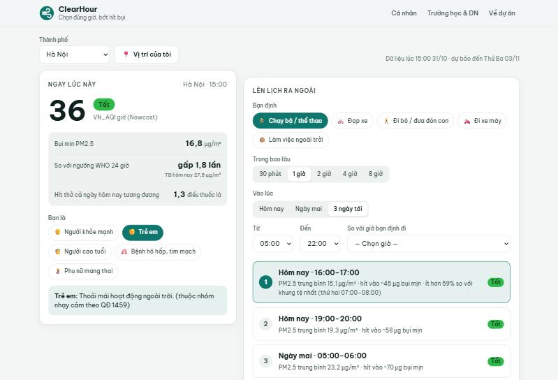

# ClearHour – Chọn đúng giờ, bớt hít bụi

**ClearHour** (tạm dịch: "giờ trong lành") là web app dùng dự báo bụi mịn PM2.5 theo giờ để gợi ý **khung giờ ra ngoài ít ô nhiễm nhất** cho từng người, từng hoạt động, và giúp trường học, doanh nghiệp điều chỉnh lịch hoạt động ngoài trời.

🔗 **Bản demo:** https://btphuong3011.github.io/clearhour/

Dự án demo cho **Youth Digital Citizen Challenge 2026** – chủ đề *Urban Air-chitects: Designing Healthier Air for Cities* (UNDP Việt Nam & Chính phủ Nhật Bản).



*[English summary below](#english-summary)*

---

## Vấn đề

- Nồng độ PM2.5 trung bình ở Việt Nam năm 2024 là **28,7 µg/m³**, gấp 5–7 lần mức khuyến nghị trung bình năm của WHO.
- Ô nhiễm không khí liên quan đến **hơn 70.000 ca tử vong mỗi năm** và gây thiệt hại ít nhất **13 tỷ USD/năm** (~4% GDP).

Người dân xem được "AQI hôm nay" nhưng con số đó hiếm khi trả lời câu hỏi thực tế: *"Vậy mấy giờ thì mình nên đi chạy bộ / đưa con ra công viên / xếp ca giao hàng?"*

Trong khi đó, bụi mịn **thay đổi rất mạnh trong ngày**. Ví dụ theo dữ liệu mô hình CAMS cho Hà Nội ngày 30/10/2026: khoảng 55 µg/m³ lúc 3–6 giờ sáng, nhưng chỉ khoảng 16 µg/m³ lúc 10 giờ sáng đến 5 giờ chiều. **Dời giờ** là cách giảm phơi nhiễm rẻ nhất, ai cũng làm được ngay.

## Giải pháp

| Tính năng | Mô tả |
|---|---|
| **Ngay lúc này** | Chỉ số VN_AQI giờ (Nowcast), PM2.5 hiện tại, so sánh với ngưỡng WHO, quy đổi "số điếu thuốc lá" hít phải trong ngày, khuyến nghị theo nhóm người (trẻ em, người cao tuổi, người có bệnh hô hấp – tim mạch, phụ nữ mang thai). Kèm **số đo thật của trạm gần nhất** (OpenAQ) để đối chiếu với dự báo. |
| **Lên lịch ra ngoài** | Chọn hoạt động (chạy bộ, đạp xe, đi bộ, đi xe máy, làm việc ngoài trời), thời lượng và khoảng giờ. App tìm 3 khung giờ có PM2.5 trung bình thấp nhất, ước tính lượng bụi hít vào và so sánh với giờ bạn định đi ("dời sang 16:00 giảm 45% lượng bụi hít vào"). Mỗi khung có nút **thêm vào Google Lịch hoặc tải tệp .ics** (nhắc trước 15 phút) để gợi ý thành hành động. |
| **Trong nhà: giờ mở cửa sổ** | Dải 24 giờ cho biết lúc nào nên mở cửa thông gió, lúc nào chỉ mở ngắn và lúc nào nên đóng kín, bật máy lọc. Hữu ích cả với người không ra đường. |
| **Biểu đồ 72 giờ** | Cột PM2.5 theo giờ, tô màu theo mức VN_AQI, đánh dấu khung được gợi ý, đường ngưỡng WHO, có bảng số liệu cho người dùng trình đọc màn hình. |
| **Chế độ Trường học & Doanh nghiệp** | Nhập các khung hoạt động cố định (giờ thể dục, ra chơi, ca giao hàng…). App đánh giá từng khung trong 3 ngày tới (tổ chức bình thường / rút ngắn / chuyển vào trong nhà) và **soạn sẵn thông báo** để gửi nhóm Zalo phụ huynh hoặc nhân viên. |

Ngoài ra: 12 đô thị lớn, "Vị trí của tôi", giao diện sáng/tối, chạy tốt trên điện thoại, link chia sẻ giữ nguyên lựa chọn (`?city=hanoi&profile=child&activity=run`), và **tự chuyển sang dữ liệu mẫu** nếu API lỗi để bản demo luôn xem được.

## Cách hoạt động

1. **Dữ liệu:** lấy dự báo PM2.5 và PM10 theo giờ (1 ngày trước + 4 ngày tới) từ [Open-Meteo Air Quality API](https://open-meteo.com/en/docs/air-quality-api), dựa trên mô hình CAMS của Copernicus.
2. **Chỉ số VN_AQI:** nội suy tuyến tính theo bảng BPi của [QĐ 1459/QĐ-TCMT (2019)](https://cem.gov.vn/storage/news_file_attach/QD%201459%20TCMT%20ngay%2012.11.2019%20AQI.pdf). Giá trị "ngay lúc này" dùng **Nowcast** (trung bình có trọng số 12 giờ gần nhất, w = max(Cmin/Cmax, 0,5)) đúng như quy định. Bộ test kiểm chứng với ví dụ tính mẫu trong văn bản.
3. **Tìm khung giờ:** trượt cửa sổ thời gian trên các giờ hợp lệ, xếp theo nồng độ trung bình tăng dần, chọn 3 khung cách nhau ít nhất 2 giờ để có những lựa chọn thật sự khác nhau.
4. **Lượng bụi hít vào** ≈ nồng độ (µg/m³) × mức thông khí (m³/giờ) × thời gian. Mức thông khí theo cường độ hoạt động lấy từ US EPA *Exposure Factors Handbook* (2011): nhẹ ~0,7, vừa ~1,6, mạnh ~3,0 m³/giờ.
5. **Quy đổi điếu thuốc:** theo Berkeley Earth, hít thở không khí có PM2.5 trung bình 22 µg/m³ trong một ngày tương đương hút khoảng 1 điếu thuốc lá.
6. **Khuyến nghị sức khỏe:** theo Bảng 5 của QĐ 1459 (người bình thường / nhóm nhạy cảm).
7. **Giờ mở cửa sổ:** PM2.5 ≤ 25 µg/m³ (mức Tốt) thì mở thoải mái, ≤ 50 µg/m³ (Trung bình) thì chỉ mở ngắn, cao hơn thì đóng kín.
8. **Số đo trạm:** GitHub Actions chạy [scripts/fetch-stations.mjs](scripts/fetch-stations.mjs) theo lịch mỗi giờ (thực tế GitHub chạy thưa hơn, vài giờ một lần), lấy số đo PM2.5 mới nhất của các trạm tại Việt Nam từ [OpenAQ](https://openaq.org/) rồi đưa vào bản deploy dưới dạng `data/stations.json`. App hiện số đo trong vòng 12 giờ, ghi rõ đo lúc nào và so với dự báo của mô hình tại đúng giờ đo. API key nằm trong GitHub Secrets nên không lộ ra trình duyệt, và cũng không tạo commit rác.

## Giới hạn

- Đây là **dữ liệu dự báo từ mô hình** với ô lưới khoảng 45 km, không chi tiết đến từng phường và không thay thế số liệu trạm quan trắc chính thức. Số đo trạm hiện mới dùng để đối chiếu, chưa dùng để hiệu chỉnh dự báo.
- Nồng độ sát mặt đường đông xe thường cao hơn mức nền của mô hình.
- Chỉ số theo từng giờ trong tương lai được quy đổi trực tiếp từ nồng độ dự báo, không dùng Nowcast.
- Lượng bụi hít vào chỉ là ước tính. **Không phải lời khuyên y tế.**

## Hướng phát triển

- **Hiệu chỉnh dự báo bằng học máy:** học độ lệch giữa dự báo CAMS và số đo trạm theo giờ trong ngày, theo mùa; công bố sai số trước/sau hiệu chỉnh. Mở rộng tới độ chi tiết quận, phường khi có thêm cảm biến.
- **Nhắc lịch chủ động:** bot Telegram / Zalo OA nhắn mỗi tối "Khung chạy bộ tốt nhất ngày mai: 16–17h".
- **Nhật ký phơi nhiễm:** "Tháng này bạn tránh được X µg bụi mịn ≈ Y điếu thuốc", vừa tạo động lực vừa đo được tác động.
- **Trợ lý AI hỏi đáp:** trả lời câu hỏi tự do ("Con tôi bị hen, chiều nay đá bóng được không?") dựa trên dữ liệu của app và khuyến nghị của QĐ 1459.
- **Mô hình bền vững:** cá nhân dùng miễn phí; trường học và doanh nghiệp có lao động ngoài trời (giao hàng, xây dựng) trả phí cho bảng điều khiển xếp ca và báo cáo phơi nhiễm hằng tháng; tài trợ CSR.
- Gợi ý tuyến đường ít ô nhiễm khi có dữ liệu chi tiết theo không gian.

## Chạy trên máy

Không cần build, không cần thư viện. Chỉ cần một web server tĩnh (vì dùng ES modules):

```bash
python -m http.server 5173
# mở http://localhost:5173
```

Chạy test (Node.js ≥ 18):

```bash
npm test
```

### Kết nối dữ liệu trạm đo (OpenAQ)

1. Đăng ký tài khoản OpenAQ miễn phí và lấy API key ([hướng dẫn](https://docs.openaq.org/using-the-api/api-key)).
2. Lưu key vào GitHub Secrets của repo (lệnh sẽ hỏi bạn dán key):

   ```bash
   gh secret set OPENAQ_API_KEY -R btphuong3011/clearhour
   ```

3. Chạy workflow ngay (không cần đợi lịch chạy mỗi giờ):

   ```bash
   gh workflow run pages.yml -R btphuong3011/clearhour
   ```

Chưa có key thì app vẫn chạy bình thường, chỉ ẩn dòng "Trạm đo gần nhất".

## Cấu trúc

```
index.html                  Giao diện
assets/styles.css           Giao diện sáng/tối, responsive
src/aqi.js                  VN_AQI, Nowcast, mức và khuyến nghị theo QĐ 1459
src/planner.js              Tìm khung giờ, liều hít vào, giờ mở cửa sổ, đánh giá lịch tổ chức
src/calendar.js             Xuất sự kiện lịch (.ics, Google Lịch)
src/stations.js             Đọc số đo trạm, tìm trạm gần nhất
src/chart.js                Biểu đồ SVG tự vẽ (không dùng thư viện)
src/api.js                  Gọi Open-Meteo, dữ liệu mẫu dự phòng
src/app.js                  Kết nối giao diện
scripts/fetch-stations.mjs  Lấy số đo trạm từ OpenAQ (chạy trong GitHub Actions)
.github/workflows/          Test + cập nhật dữ liệu trạm + deploy GitHub Pages mỗi giờ
data/                       Dữ liệu mẫu Hà Nội, số đo trạm
tests/                      Unit test (node:test)
```

## Nguồn dữ liệu & ghi công

- Dữ liệu chất lượng không khí: [Open-Meteo.com](https://open-meteo.com/) – CAMS ENSEMBLE, Copernicus Atmosphere Monitoring Service (CC BY 4.0).
- Số đo trạm quan trắc và cảm biến: [OpenAQ](https://openaq.org/).
- Chỉ số VN_AQI: Quyết định 1459/QĐ-TCMT ngày 12/11/2019 của Tổng cục Môi trường.
- Ngưỡng tham chiếu: WHO Global Air Quality Guidelines (2021) – PM2.5 trung bình 24 giờ 15 µg/m³.
- Số liệu bối cảnh: YDCC 2026 Booklet (UNDP Việt Nam).

---

## English summary

**ClearHour** turns hourly PM2.5 forecasts into a concrete answer: *when* is the cleanest time to go outside. It ranks time windows for a chosen activity and duration, estimates inhaled dose (concentration × ventilation rate × time), shows Vietnam's official VN_AQI (Decision 1459/QĐ-TCMT, including Nowcast) with health advice for sensitive groups, and offers a school/business mode that evaluates fixed outdoor schedules for the next 3 days and drafts a ready-to-send notice. Recommended windows can be added to Google Calendar or downloaded as .ics reminders; an indoor view shows when to open or close windows over the next 24 hours; and the nearest monitoring station's latest reading (OpenAQ, refreshed hourly by GitHub Actions) is shown next to the forecast. Static site, no build step, falls back to bundled sample data if the forecast API is unreachable. Built as a demo for UNDP Viet Nam's Youth Digital Citizen Challenge 2026.

## Giấy phép

MIT © 2026 [btphuong3011](https://github.com/btphuong3011)
